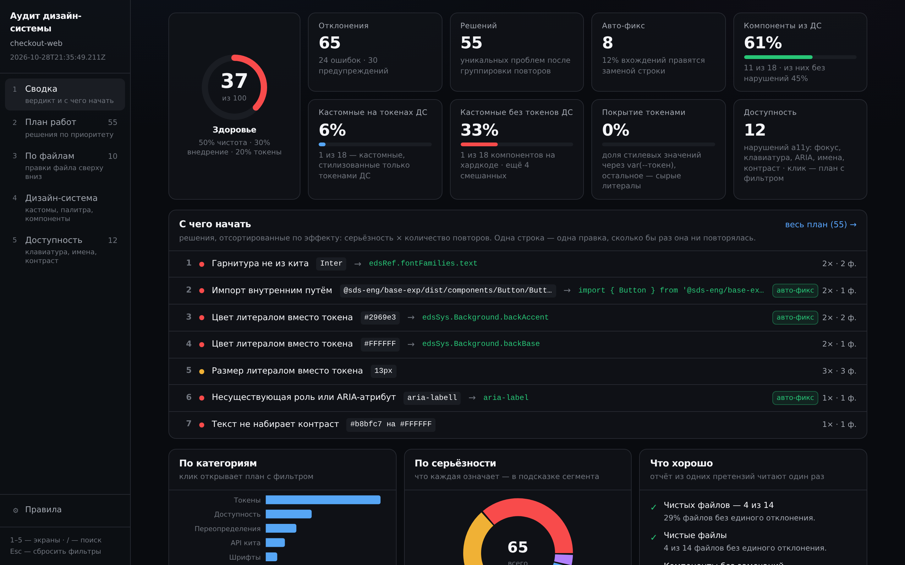
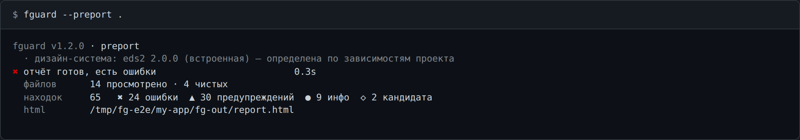

# Frontend Guard

`fguard` — утилита командной строки: читает фронтенд-проект как есть и отдаёт отчёт по доступности,
дизайн-системе, компонентам и иконкам, а из макета Pixso собирает готовые артефакты.



## Что на выходе

- **Один самодостаточный `report.html`** — интерактивный дашборд: открывается двойным кликом,
  работает офлайн, в сеть не ходит.
- **Проверяемому проекту ничего не нужно** — ни зависимостей, ни сборки: анализ читает исходники.
- **Один проход — сколько угодно форматов**: `html`, `summary`, `compact`, `json`, `sarif`.
- **Код возврата роняет сборку**: `0` — ошибок нет, `1` — есть ошибки, `2` — неверный вызов.
- **Макет Pixso → svg / html / md / json** одной командой.
- **Навыки для CLI-агента**: спецификация и HTML кадра Pixso, отчёт по проекту — прямо из чата.

## Установка

Релиз — три файла: `fg.mjs` (вся программа, без внешних зависимостей), `install` и
`ru-code-install` (установщик ru-code, дословно).

```bash
git clone <репозиторий релиза> fguard-release
bash fguard-release/install                 # команда fguard + навыки CLI + плагин pixso для ru-code
fguard token                                # токен Pixso, скрытым вводом (один раз)
```

Нужен Node 22.16+ — `install` ищет его так же, как установщик ru-code (сначала node, который
поставляется с CLI). Повторный `bash install` — обновление; `bash install --uninstall` — удаление
(или `bash <корень ru-code>/fg/install --uninstall`, если клона уже нет). После установки
откройте новый терминал. Подробно — [docs/manual/setup.md](docs/manual/setup.md).


Без установки `fg.mjs` можно запускать и напрямую: `node fg.mjs --help`. Если файлов релиза на
вашем чекауте нет — `pnpm install && pnpm release` (подробнее — [CONTRIBUTING.md](docs/CONTRIBUTING.md)).

## Две основные команды

### 1. Отчёт по проекту — `--preport`

```bash
fguard --preport .                                  # → ./fg-out/report.html
fguard --preport . --format compact                 # находки в консоль
fguard --preport . --format html,sarif -o ./report  # два документа за один проход
```



Аргумент — каталог на диске или ссылка на репозиторий (`http(s)://…`, `git@…`, `file://…`);
репозиторий клонируется во временный каталог и удаляется после анализа. Дизайн-система
(`eds` 1.x / `eds2` 2.x) определяется по зависимостям проекта, снимок обеих вшит в бандл.

Подробно: [docs/manual/project-report.md](docs/manual/project-report.md).

### 2. Кадр Pixso → четыре файла — `--passets`

```bash
fguard token                                # токен удалённого MCP, один раз (docs/manual/token.md)
fguard --passets <pixso-link>                   # → ./fg-out/pixso/<item-id>/card.{svg,html,md,json}
fguard --passets <pixso-link> -o ./card         # -o задаёт каталог
```

```
$ fguard --passets <pixso-link>
fguard v1.2.0 · passets · удалённый маршрут · item 11-10
✔ готово
  svg    /home/u/app/fg-out/pixso/11-10/card.svg
  html   /home/u/app/fg-out/pixso/11-10/card.html
  md     /home/u/app/fg-out/pixso/11-10/card.md
  json   /home/u/app/fg-out/pixso/11-10/card.json
```

`<pixso-link>` — ссылка на кадр из Pixso («Поделиться → Копировать ссылку»), в ней есть `item-id`.

Каталог по умолчанию назван по этому `item-id`, приведённому к безопасному имени файла: на снимке
выше это `./fg-out/pixso/11-10/`, внутри — четыре `card.*`. Токен можно задать и иначе — флагом
`--token`, переменной `PIXSO_REMOTE_MCP_TOKEN` или строкой в `./.env` проекта; они сильнее файла
`fguard token`. Нет токена или он отклонён — код 3 и готовая команда `fguard token <ваш токен>`.

Один запрос к макету → четыре файла. Рядом — три команды по одному файлу каждая: `--psvg` (SVG),
`--phtml` (HTML), `--pprompt` (Markdown-промпт для LLM).

Подробно: [docs/manual/pixso.md](docs/manual/pixso.md), переменные — [docs/manual/env.md](docs/manual/env.md).

## Плагин pixso для ru-code — `install`

`bash install` ставит плагин сам; эти команды — чтобы проверить, переустановить или убрать только его.

```bash
fguard install                # поставить плагин pixso в ru-code (и перезапустить ru-code, если он запущен)
fguard install --check        # только проверить: установлен ли, совпадает ли со встроенным
fguard install --no-restart   # поставить, но не перезапускать
fguard uninstall              # удалить плагин; его данные остаются
```

Сборка плагина вшита в `fg.mjs`. Где лежит ru-code, fguard узнаёт у **собственного preflight-скрипта
ru-code** — того же, что запускает установщик ru-code, — и пишет в
`<корень ru-code>/plugins/pixso` (рабочие файлы — в `<корень>/.fg-install/`, вне `plugins/`).
Замена атомарная: прежняя папка остаётся целой, пока новая не записана и не сверена по sha256;
два одновременных запуска не пересекутся (блокировка). Данные плагина (`userdata/plugins/pixso`) и переключатели
вкл/выкл не трогаются.

Перезапуск — только если ru-code запущен и файлы изменились: `ru-code restart --no-browser`
(без новой вкладки браузера), тем же способом, что у установщика ru-code: node напрямую, на любой ОС. Не запущен — плагин загрузится при следующем старте. Если текущая
версия ru-code сама поставляет pixso, ru-code загрузит свою копию — fguard об этом предупредит.

Плагину нужен ru-code **не старше 0.0.34** (`MINIMUM_APP_VERSION` в
`packages/fg-install/src/constants.ts`): в 0.0.33 нет API хоста, без которого ru-code пометит плагин
как сломанный. Версию fguard берёт из `<корень ru-code>/bin/current.json`. Если ru-code старее или
версию не прочитать, `fguard install` ничего не пишет и выходит с кодом 1:
`✖ установлен ru-code 0.0.33, а плагину pixso нужен 0.0.34 или новее` — обновите ru-code и повторите.
`fguard uninstall` версию не проверяет.

Подробно: [docs/manual/install.md](docs/manual/install.md). Как обновить вшитую сборку —
[CONTRIBUTING.md](docs/CONTRIBUTING.md#сборка-ru-code-для-fg-install).

## Навыки для CLI-агента

`bash install` кладёт в папку навыков CLI три навыка: `fg:get-pixso-specs` (спецификация кадра),
`fg:get-pixso-html` (HTML/CSS кадра) и `fg:project-report` (отчёт по проекту: спросит каталог или
git-URL, ответит цифрами из `report.summary.json` и ссылкой на дашборд). Команды в них — с
абсолютными путями node и `fg.mjs`. Подробно — [docs/manual/skills.md](docs/manual/skills.md).

## Роли

- [Разработчик](docs/manual/roles/developer.md) — прогнать свой проект и починить найденное.
- [Дизайнер](docs/manual/roles/designer.md) — достать кадр из макета, собрать корпус дизайн-системы.
- [Ревьюер / тимлид](docs/manual/roles/lead.md) — читать дашборд, следить за здоровьем и
  внедрением, понижать правила конфигом.

## Документация

| Документ                                                  | О чём                                                                         |
| --------------------------------------------------------- | ----------------------------------------------------------------------------- |
| [manual/project-report.md](docs/manual/project-report.md) | `--preport`: флаги, форматы, `-o`, коды возврата, конфиг правил               |
| [manual/pixso.md](docs/manual/pixso.md)                   | `--psvg/--phtml/--pprompt/--passets`, маршруты, токен                         |
| [manual/init-config.md](docs/manual/init-config.md)       | `--iconf`: `fg.config.json`, схема, `inherit`                                 |
| [manual/parse-ui-kit.md](docs/manual/parse-ui-kit.md)     | `--pkit`: пересборка корпуса дизайн-системы                                   |
| [manual/setup.md](docs/manual/setup.md)                   | `bash install`: команда `fguard`, node, rc-файлы, обновление, удаление        |
| [manual/token.md](docs/manual/token.md)                   | `fguard token`: где хранится токен, приоритет, код 3                          |
| [manual/skills.md](docs/manual/skills.md)                 | три навыка CLI-агента                                                         |
| [manual/install.md](docs/manual/install.md)               | `install` / `uninstall`: плагин pixso в ru-code, перезапуск, коды возврата    |
| [manual/env.md](docs/manual/env.md)                       | все переменные окружения и приоритет                                          |
| [manual/ci.md](docs/manual/ci.md)                         | пайп, `sarif`/`json`, коды возврата, `NO_COLOR`                               |
| [manual/vscode.md](docs/manual/vscode.md)                 | задачи VS Code и просмотр SARIF                                               |
| [ARCHITECTURE.md](docs/ARCHITECTURE.md)                   | пакеты, поток данных, инварианты, адаптеры                                    |
| [CONTRIBUTING.md](docs/CONTRIBUTING.md)                   | инструменты, проверки, релиз, как добавить правило / команду / дизайн-систему |
| [CHANGELOG.md](docs/CHANGELOG.md)                         | что вошло в 1.0.0, 1.1.0 и 1.2.0                                                     |

Справка в самом инструменте: `fguard --help`, по команде — `fguard --help --preport`.
