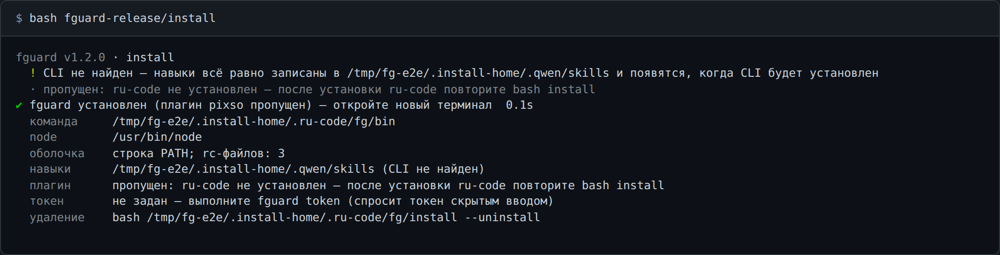

# `bash install` — установка fguard

```bash
git clone <репозиторий релиза> fguard-release
bash fguard-release/install                 # установить или обновить
bash fguard-release/install --uninstall     # удалить
```

Релиз — три файла: `fg.mjs` (вся программа), `install` (этот установщик) и `ru-code-install`
(установщик ru-code, дословная копия). Один запуск `bash install` ставит:

| Что                    | Куда                                                         |
| ---------------------- | ------------------------------------------------------------ |
| команда `fguard`       | `<корень ru-code>/fg/bin/` + строка в rc-файлах оболочки     |
| три навыка для CLI     | `<папка CLI>/skills/` — см. [skills.md](skills.md)           |
| плагин pixso для ru-code | `<корень ru-code>/plugins/pixso` — если ru-code установлен и не старше 0.0.34 |

Токен Pixso установка не спрашивает — его задают потом командой [`fguard token`](token.md).



## Node

Node ищет не fguard, а **код установщика ru-code**: `install` подключает `ru-code-install` и
вызывает его же функции `detect_os` и `check_node_floor`. Поэтому node будет тот же, что выбрал бы
установщик ru-code на этой машине: сначала node, который поставляется вместе с CLI (если он
есть по пути, заданному в сборке ru-code), затем `node` из `PATH`, не ниже 22-й версии.
Этот путь записывается в команду `fguard` и во все команды навыков — от `PATH` в новом
терминале они не зависят.

Нет node — тот же отказ, что у установщика ru-code, код 1, ничего не записано:

```
  ✖ Node.js не установлен
    Установите LTS: https://nodejs.org/ и запустите заново.
```

Старый node — «Обновите Node.js», нужна версия `^22.16 || ^23.11 || >=24.10`.

## Где ru-code и CLI

Корень ru-code и папку CLI называет **preflight ru-code** — тот же скрипт, что запускает
установщик ru-code (вшит в `fg.mjs`): `OUR_ROOT=` и `CONFIG_DIR=`. Сам fguard эти пути не
вычисляет. На Linux при существующем `/home/work/<пользователь>` корень —
`/home/work/<пользователь>/.ru-code`.

ru-code может быть не установлен: `bash install` создаст нужные папки и поставит команду и
навыки, а плагин пропустит со строкой `пропущен: ru-code не установлен`. Нет CLI — навыки всё
равно записываются, а установка говорит `CLI не найден — навыки всё равно записаны в …`. ru-code
старее 0.0.34 — плагин пропущен с тем же сообщением, что у [`fguard install`](install.md),
остальное ставится. Во всех трёх случаях код 0, а заголовок итога —
`fguard установлен (плагин pixso пропущен)`.

## Команда `fguard`

В `PATH` попадает только `<корень ru-code>/fg/bin/`, и в нём только имена, которых нет у
системных команд: `fg.mjs`, обёртка `fguard`, (в режиме env.sh) `env.sh` и токен `.env`.
Установщики `install` и `ru-code-install` лежат уровнем выше, в `<корень ru-code>/fg/`, — вне `PATH`,
чтобы не перекрыть системную `install`. Строку в `~/.bashrc`, login-файл bash и `~/.zshrc` (и
`$ZDOTDIR/.zshrc`, если задан) пишут **функции установщика ru-code** (`create_wrapper`,
`clean_rc`, `add_path`) — с путями fguard. Вид строки — тот, что вшит в сборку ru-code:

| Режим ru-code              | Строка в rc                                              | Команда                          |
| -------------------------- | -------------------------------------------------------- | -------------------------------- |
| классический               | `export PATH="<корень>/fg/bin:$PATH"`                    | файл-обёртка `<корень>/fg/bin/fguard` |
| env.sh (`USE_RC_SOURCED_LAUNCHER`) | `[ -f "<корень>/fg/bin/env.sh" ] && . "<корень>/fg/bin/env.sh"` | функция `fguard` из `env.sh`      |

Переключатель ru-code `INSTALL_USE_RC_SOURCED_LAUNCHER=true|false` действует и здесь. После
установки откройте новый терминал. Почему не `fg`: это встроенная команда bash и zsh (управление
заданиями), её не перекрыть файлом в `PATH`.

**ru-code и fguard не трогают строки друг друга.** Метка строки ru-code — `/.ru-code/bin`, метка
fguard — `/.ru-code/fg/bin`: установка, обновление и удаление ru-code оставляют строку fguard на
месте, `bash install --uninstall` — строку ru-code. Папку `<корень>/fg/` ru-code не удаляет: его
установщик удаляет только `<корень>/bin`, а встроенное обновление работает внутри `bin`.

**Исключение — переезд корня ru-code на Linux.** Если каталог `/home/work/<пользователь>`
появился уже после установки fguard, следующая установка или обновление ru-code переносит его
корень туда и удаляет весь старый `~/.ru-code` целиком — так устроен установщик ru-code
(`remove_legacy_root`, `ru-code/installer/parts/30-core.sh:423-437`; вызывается из
`40-main.sh:46`), вместе с его собственными `userdata` и `plugins`. С ним уходит и `~/.ru-code/fg/`:
команда `fguard`, сохранённый токен и `fg.mjs`, на который ссылаются навыки. Строка fguard в
rc-файлах остаётся, но ни на что не указывает. Навыки в этом случае сразу останавливаются с
сообщением `fguard не найден: <путь>/fg.mjs. Установите его заново: склонируйте репозиторий релиза
fguard и выполните в нём bash install`. Что делать: заново `bash install` из клона релиза (fguard
встанет в новый корень `/home/work/<пользователь>/.ru-code/fg/`, а старую строку в rc-файлах уберёт
сам) и снова `fguard token`.

## Повторный запуск = обновление

Тот же `bash install` из нового релиза обновляет `fg.mjs`, навыки и плагин; токен в
`<корень ru-code>/fg/bin/.env` сохраняется. Строка fguard в rc-файлах не дублируется — содержимое
файлов после повтора то же байт в байт, — но каждый rc-файл, где она стоит, **перезаписывается**
и его `<файл>.bak` обновляется: это порядок самого установщика ru-code — сначала `clean_rc`
убирает строку, затем `add_path` дописывает её снова (`ru-code/installer/parts/40-main.sh:35-36`),
а запись, отличная от текущего файла, сначала копирует его в `.bak`
(`25-rc-path.sh:277-287`). Ход записи — в `<корень ru-code>/fg/install.log`.

## Удаление

```bash
bash <корень ru-code>/fg/install --uninstall   # работает и когда клона релиза уже нет
```

Удаляется: строка fguard из rc-файлов (строки ru-code и ваши — байт в байт как были), три папки
навыков (другие навыки не трогаются), плагин pixso (как [`fguard uninstall`](install.md), с
перезапуском ru-code, если он запущен) и вся папка `<корень ru-code>/fg/` — **вместе с
токеном**; итог об этом говорит: `… удалена вместе с токеном (.env)`.

## Коды возврата

| Код | Когда                                                                         |
| --- | ----------------------------------------------------------------------------- |
| `0` | установлено (в том числе с пропущенным плагином) / удалено                    |
| `1` | нет node или он старый; не удалось записать файлы или навыки; ru-code не перезапустился |
| `2` | `setup` / `teardown` вызваны не из `install`                                  |
