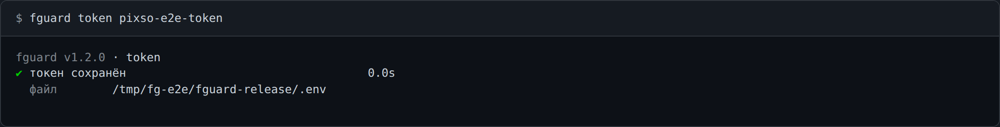

# `fguard token` — токен Pixso

```bash
fguard token              # спросит токен скрытым вводом (не попадёт ни на экран, ни в историю)
fguard token <токен>      # то же, значением
echo "$T" | fguard token  # из пайпа — первая строка
```

Записывает `PIXSO_REMOTE_MCP_TOKEN` в файл `.env` рядом с `fg.mjs` — после
[`bash install`](setup.md) это `<корень ru-code>/fg/bin/.env` — и печатает абсолютный путь к нему.
Права файла — `600`. Строка заменяется, остальные строки файла остаются; кавычки ставятся, только
если без них значение не прочиталось бы обратно.



## Откуда берётся токен

Для каждой команды Pixso, по убыванию силы:

1. флаг `--token <токен>`;
2. переменная окружения `PIXSO_REMOTE_MCP_TOKEN` или строка в `./.env` текущего каталога;
3. `.env` рядом с `fg.mjs` — тот, что пишет `fguard token`;
4. пусто.

Подробнее о `.env` — [env.md](env.md).

## Когда токена нет или он не подошёл

Команды Pixso выходят с кодом **3** и называют готовую команду и файл:

```
✖ нет токена Pixso для ссылки на кадр. Выполните: fguard token <ваш токен> — токен сохранится в файле /home/u/.ru-code/fg/bin/.env
✖ токен Pixso отклонён сервером (HTTP 401). Задайте новый: fguard token <ваш токен> — токен сохранится в файле /home/u/.ru-code/fg/bin/.env
```

«Отклонён» — когда сервер ответил HTTP 401 или 403 (этот статус pixso-core передаёт отдельным
полем, не текстом). Сервер недоступен или ответил другой ошибкой — код 1. Локальный маршрут (guid)
токена не требует.

## Коды возврата `fguard token`

| Код | Когда                                                              |
| --- | ------------------------------------------------------------------ |
| `0` | записано                                                           |
| `1` | файл не записать (например, на его месте каталог)                  |
| `2` | пустой токен или такой, что `.env` не может хранить               |

`bash install --uninstall` удаляет `<корень ru-code>/fg/` вместе с этим файлом.
